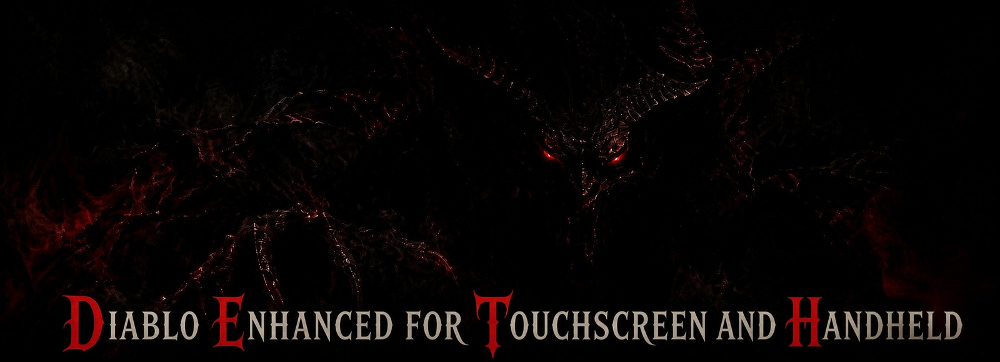
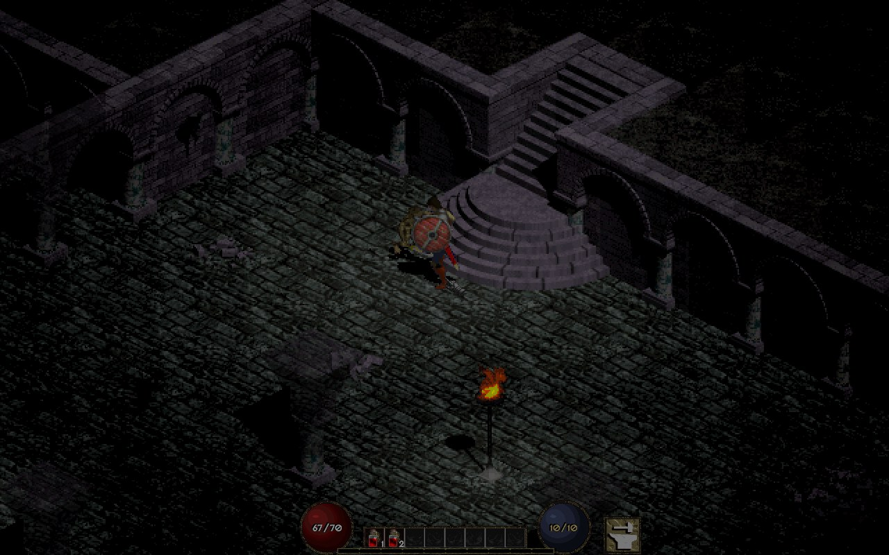
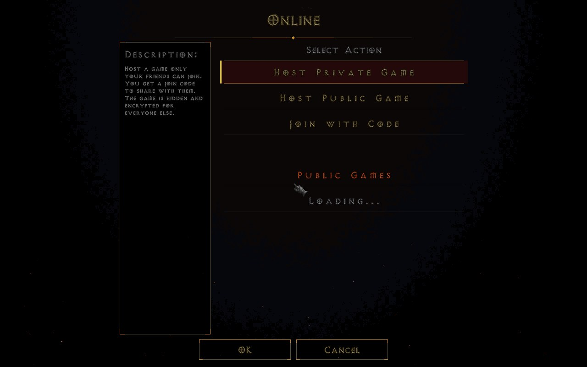
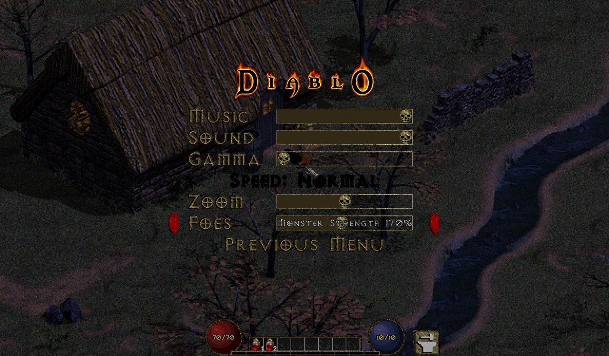
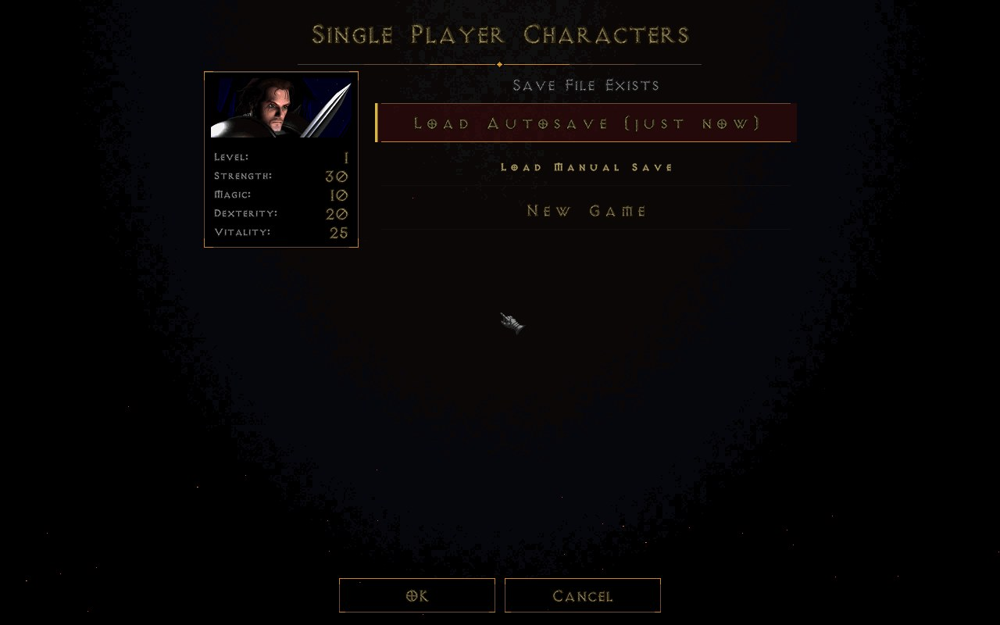
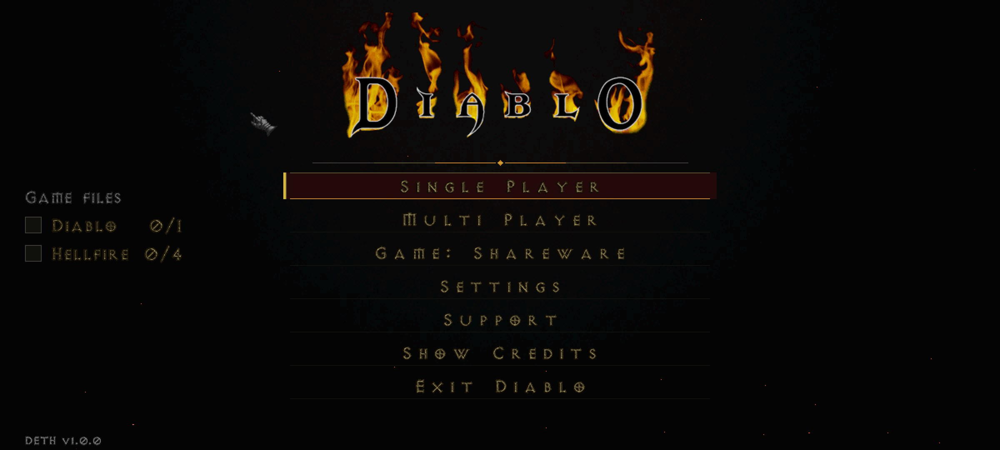
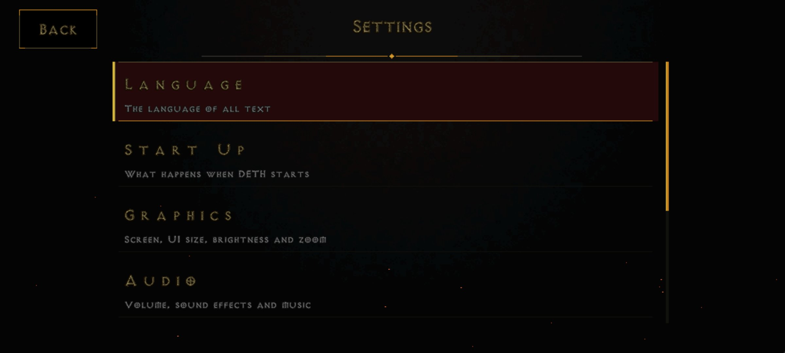

<p align="center">
  
</p>

<p align="center">
  Diablo and Hellfire on your phone, your handheld and your PC. Touch controls, a controller layout that fits a Steam Deck or ROG Ally, online play with friends by code, autosave, mods, and updates from inside the game.<br>
  <a href="../../releases/latest"><b>Download the latest release</b></a> &nbsp;·&nbsp; Android APK &nbsp;·&nbsp; Windows zip &nbsp;·&nbsp; SteamOS / Linux Flatpak
</p>

## What you get

- **Built for touch and controllers.** Compact HUD with the belt on the bottom edge, on-screen controls on phones, an Xbox-style layout with a right-stick cursor, zoom and UI scale set independently.
- **Combat that flows on a pad.** Hold A and every attack goes to the nearest enemy, like tapping. Push the stick while holding A to step between attacks; once a hit lands, the stick walks you away at once. With the stick pushed, bows and spells go for the enemy in that direction.
- **Play with friends, by code only.** Online: host a private game and share a 10-character join code; no account, no extra app, and only people with the code can find the game. Same Wi-Fi: a 6-character code. Nobody ever sees or types an address.
- **Never lose a character.** Autosave every 2 minutes, kept apart from your own saves. Single Player opens with Continue and your recent saves, and each hero keeps its last 5 saves to go back to. Saves live in `Downloads/DETH`, so they survive an uninstall and copy between devices.
- **Shareware, Diablo or Hellfire.** The free shareware is built in. Import Game Files takes `DIABDAT.MPQ`, the Hellfire files, a folder, a zip, 7z, rar or tar.gz (also password protected, also archives inside archives) or GOG's installer on PC, and lists what it finds in Downloads so a controller can pick it. A checklist on the main menu shows what is installed.
- **Your stash, anywhere.** Learn it from Cain and the stash opens beside your inventory wherever you are.
- **Better stores.** Every weapon shows its damage per second, and your own items are grouped by kind when you sell, repair, recharge or identify.
- **Mods, all on from the start.** Scroll Books (Adria sells slim tomes that hold 50 scrolls), Gold Magnet, floating damage and XP numbers, a clock and Adria refilling mana; switch any of them off under Settings > Mods. Joining a game with different mods offers to use the host's for that game only.
- **Monster Strength.** In multiplayer the host sets it from 50% to 300%: monsters hit harder, take longer to kill and give more experience.
- **Updates in the game.** Settings > Check for Updates, with a Stable and a Beta channel.

<p align="center">
  
  
</p>
<p align="center">
  
  
</p>
<p align="center">
  
  
</p>

## Install

**Android:** install `DETH<version>.apk` (allow installs from unknown sources). On first start choose **Import Game Files** and pick `DIABDAT.MPQ` or an archive with it (zip, 7z, tar.gz, also password protected), or play the shareware. Allow "All files access" when asked so saves can live in Downloads.

**Windows:** unzip `DETH<version>-windows.zip` anywhere and run `DETH.exe`. Settings stay in that folder; saves go to `Downloads\DETH\saves`. For the full game, choose **Import Game Files** and pick your files or archive (from Downloads, the DETH folder or Browse), or copy `DIABDAT.MPQ` into the folder.

**SteamOS and Linux:** open `DETH<version>.flatpak` in Desktop Mode (Discover installs it) or run `flatpak install --user DETH<version>.flatpak`. For the full game, put your files or archive in `~/Downloads` and choose **Import Game Files**, or copy `DIABDAT.MPQ` into `~/Downloads/DETH`. In Steam, **Add a Non-Steam Game** and pick DETH.

Hellfire on any platform: also `hellfire.mpq`, `hfmonk.mpq`, `hfmusic.mpq` and `hfvoice.mpq`, next to `DIABDAT.MPQ`.

## Multiplayer

**Online:** Multi Player > Online > Host Private Game. The game menu shows a join code like `7Q2MXP4DK9`; friends choose Join with Code and type it. Host Public Game lists the game for anyone.

**Same Wi-Fi:** Multi Player > Client-Server (TCP) > Create Game. The game menu shows a 6-character Wi-Fi code like `7Q2MXP`; friends on the same network choose Join Game and type it. No addresses anywhere.

Everyone needs the same game (Shareware, Diablo or Hellfire) and the same DETH version. When the host leaves, the game ends for everyone.

## Controls

| Controller | In game | In menus |
|---|---|---|
| Left stick | Move | Navigate |
| Right stick, RS click | Free cursor, left click | |
| A / X / B / Y | Attack or talk (hold to keep attacking) / interact / cancel / spell select | Select / use / back |
| RT / LT | Cast / hold position | |
| LB / RB | Health / mana potion | |
| D-pad | Spellbook, Quest log, Character, Inventory | Navigate |
| View + A, B, X, Y | Quick spells | |
| Menu | Game menu | |

On the main menu, Left and Right open the corner buttons: the game (Diablo, Hellfire or shareware) and Import Game Files. Change any button under Settings > Gamepad Mapping.

| Keyboard | Action |
|---|---|
| W A S D | Move |
| 1 to 8 | Belt |
| I / C / Q / T | Inventory / Character / Quest log / Spellbook |
| F | Spell select; F5 to F8 quick spells |
| Tab / M | Map / map style |
| Space | Close panels |
| Alt (hold) | Show items on the ground |
| Page Up / Page Down | Zoom |
| Esc | Menu |

## Building

```
cmake -S. -Bbuild -DCMAKE_BUILD_TYPE=Release -DDISCORD_INTEGRATION=OFF
cmake --build build -j$(nproc)
```

Android: `android-project` (Gradle). Flatpak: `Packaging/flatpak`. Windows: MinGW cross build (`.github/workflows/Windows.yml`). Releases are built and published by GitHub Actions.

## License

Free for non-commercial use under the terms in `LICENSE.md`; the components DETH is built from are listed in `THIRD_PARTY.md`. Diablo and Hellfire are trademarks of Blizzard Entertainment; DETH is not affiliated with or endorsed by Blizzard.
