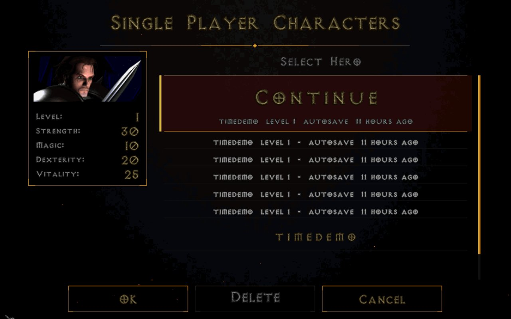

<p align="center">
  
</p>

<p align="center">
  Diablo and Hellfire for phones, handhelds and PCs: touch and controller play, online games by code, autosave, mods and in-game updates.<br>
  <a href="../../releases/latest"><b>Download the latest release</b></a> &nbsp;·&nbsp; Android APK &nbsp;·&nbsp; Windows zip &nbsp;·&nbsp; SteamOS / Linux Flatpak
</p>

## Features

- **Touch and controllers.** On-screen controls on phones, an Xbox-style layout with a right-stick pointer, and UI size and zoom set separately. Phones get a UI Size slider on the main menu.
- **Combat on a pad.** Hold A to keep attacking the nearest enemy. Push the stick while holding A to step between attacks; bows and spells aim where the stick points.
- **Online by code.** Host a private game and share a 10-character code. No account, no addresses. On the same Wi-Fi, a 6-character code.
- **Never lose a character.** Autosave every 2 minutes. Single Player opens with Continue and your recent saves; each hero keeps its last 5. Saves live in `Downloads/DETH`, so they survive an uninstall.
- **Shareware, Diablo or Hellfire.** The shareware is built in. Import Game Files takes your game files or an archive with them (zip, 7z, rar, tar.gz, GOG installer).
- **Heraldic Vault.** Cain teaches it for 50,000 gold: your stash opens beside the inventory anywhere, gold goes straight into it, and gear equips straight from it.
- **A bigger pack.** Cain sells up to 2 extra inventory rows (10,000 gold each); the inventory keeps its size.
- **Tidy inventory.** Sort keeps like items together, and picking something up moves items to make room.
- **Better stores.** Weapons show damage per second; your items are grouped by kind when you sell or repair.
- **Mods, on from the start.** Scroll Books, Gold Magnet, floating damage and XP numbers, a clock and Adria refilling mana. Switch them off under Settings > Gameplay.
- **Monster Strength.** The multiplayer host sets it from 50% to 300% for tougher fights and more experience.
- **Updates in the game.** Settings > Check for Updates.

<p align="center">
  
  
</p>
<p align="center">
  
  
</p>
<p align="center">
  
  
</p>

## Install

**Android:** install `DETH<version>.apk` (allow installs from unknown sources) and allow "All files access" so saves can live in Downloads.

**Windows:** unzip `DETH<version>-windows.zip` anywhere and run `DETH.exe`.

**SteamOS / Linux:** open `DETH<version>.flatpak` in Desktop Mode, or run `flatpak install --user DETH<version>.flatpak`. In Steam, use **Add a Non-Steam Game**.

**Full game:** choose **Import Game Files** and pick `DIABDAT.MPQ` or an archive with it. For Hellfire, also `hellfire.mpq`, `hfmonk.mpq`, `hfmusic.mpq` and `hfvoice.mpq`.

## Multiplayer

**Online:** Multi Player > Online > Host Private Game, then share the code from the game menu. Friends choose Join with Code.

**Same Wi-Fi:** Multi Player > Client-Server (TCP) > Create Game, then share the 6-character code. Friends choose Join Game.

Everyone needs the same game and DETH version. The game ends when the host leaves.

## Controls

| Controller | In game | In menus |
|---|---|---|
| Left stick / D-pad | Move / panels | Navigate |
| Right stick, RS click | Pointer, click | Pointer |
| A | Attack or talk (hold to keep attacking) | Select |
| X / B / Y | Interact / cancel / spell select | Use / back |
| RT / LT | Cast / hold position | |
| LB / RB | Health / mana potion | |
| View + A, B, X, Y | Quick spells | |
| Menu | Game menu | |

With the stash open, X uses an item and Y moves it between the inventory and the stash. Change any button under Settings > Controls > Controller.

| Keyboard | Action |
|---|---|
| W A S D | Move |
| 1 to 8 | Belt |
| I / C / Q / T | Inventory / Character / Quest log / Spellbook |
| F, F5 to F8 | Spell select, quick spells |
| Tab / M | Map / map style |
| K | Sort inventory |
| Alt (hold) | Show items on the ground |
| Page Up / Page Down | Zoom |
| Esc | Menu |

## Building

```
cmake -S game -B build -DCMAKE_BUILD_TYPE=Release -DDISCORD_INTEGRATION=OFF
cmake --build build -j$(nproc)
```

Android: `game/android-project` (Gradle). Flatpak: `game/Packaging/flatpak`. Windows: MinGW cross build. Releases are built by GitHub Actions.

## License

Free for non-commercial use under `LICENSE.md`; components are listed in `THIRD_PARTY.md`. Diablo and Hellfire are trademarks of Blizzard Entertainment; DETH is not affiliated with or endorsed by Blizzard.
