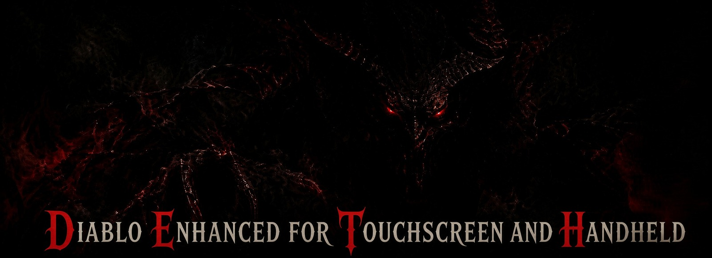

- **Android:** install `DETH<version>.apk` (allow installs from unknown sources).
- **Windows:** unzip `DETH<version>-windows.zip` and run `DETH.exe`.
- **SteamOS / Linux:** open `DETH<version>.flatpak` in Desktop Mode, then add DETH to Steam as a Non-Steam Game.
- **Full game:** choose Import Game Files and pick `DIABDAT.MPQ` or an archive with it. The shareware is built in.

**What's new in 1.6**
- Rogue quiver: 5 quick shots that refill one arrow per second; Cain upgrades it to 10 (5,000 gold) and 20 (20,000 gold)
- Everyone regains 1 mana per second; Adria raises it to 5 for the Sorcerer (5,000 / 10,000 / 20,000 / 40,000 gold)
- Everyone regains 5 life per minute; Pepin raises it to 25 for the Warrior and Monk (same prices)
- An X in the corner of every panel closes it with the mouse or a tap
- Chat button on the menu strip; chat makes a sound and your whispers are marked
- Controller shortcuts with Select: Up chat, Down sort inventory, Left chat log, Right map type, Left Stick party
- Exit, Quit, Load and Sell Junk ask you to press again
- Settings open in multiplayer while the game keeps running
- Key bindings say what a new key unbound, plus Reset all keys
- New games start on your last connection, difficulty and speed; Quick (125%) speed added
- Gold and stash amounts start at the most you can move and step by sensible amounts
- New defaults: music 40%, sound 50%, Walking SFX 20%, speed 125%, map 50%; Hellfire starts first when its files are found
- Windows on SteamOS switches Steam to game controls when a controller is found
- Android: Compatible Audio option for headphones that drift in volume; Large Text on every device
- Fixes: a text box crash, chat log scrolling, the spellbook ignoring A, and more
